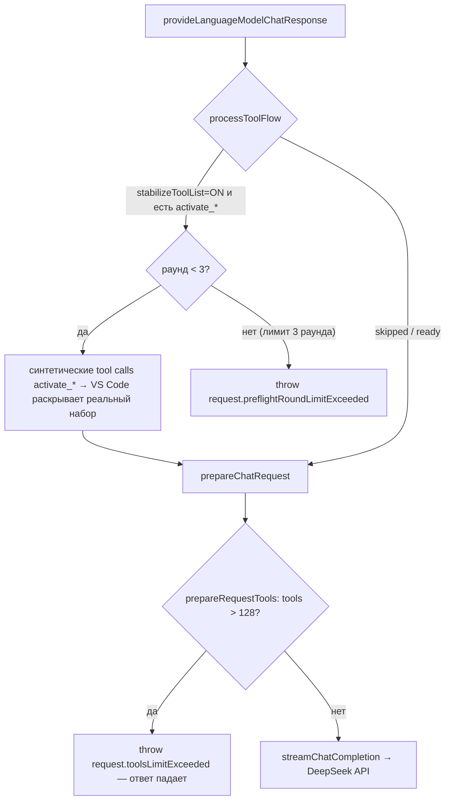

# План: «бюджет инструментов» — убрать падение ответа при >128 инструментах

| | |
|---|---|
| **Статус** | v2 реализована в рабочей копии (разделы 4 и 8, не закоммичено); локальная сборка `dist/deepseek-v4-for-copilot-0.9.2.vsix` установлена |
| **Дата** | 2026-09-21 |
| **База** | `main` @ `v0.9.2` (`9b29b14`) |
| **Область** | `src/provider/tools/**`, `src/provider/request.ts`, `src/provider/index.ts`, `src/config.ts`, `src/i18n.ts`, `package*.json`, `docs/**` |

## 1. Проблема

В Copilot-режиме с большим числом включённых инструментов (встроенные + расширения + MCP-серверы, плюс `activate_*` от `experimental.stabilizeToolList`) **ответ завершается ошибкой**, чат «залипает»: каждый следующий ход падает, пока не отключить инструменты.

DeepSeek Chat Completions API принимает **не более 128 функций** в одном запросе. Провайдер обязан гарантировать этот контракт сам, но сейчас он делает это **падением запроса**, а не деградацией.

### Когда набор превышает 128 (проверено по исходникам Copilot Chat)

Copilot Chat **не читает** числовое `capabilities.toolCalling` провайдера. Порог виртуальных инструментов берётся из настройки `github.copilot.chat.virtualTools.threshold` (по умолчанию `HARD_TOOL_LIMIT = 128`, `0` = отключить группировку). При превышении порога Copilot группирует инструменты в `activate_*` и сворачивает наименее используемые группы обратно до лимита. Значит, провайдер видит >128 инструментов в двух случаях:

1. Пользователь поднял или обнулил `virtualTools.threshold` (частый совет в issue-трекерах «чтобы не было `activate_*`»).
2. Включён `experimental.stabilizeToolList`: preflight принудительно раскрывает все группы, и суммарный набор перерастает лимит.

Оба случая нужны в ручной проверке (раздел 6).

## 2. Где именно ломается

| Место | Роль в проблеме |
|---|---|
| `src/provider/tools/consts.ts` | `DEEPSEEK_TOOLS_LIMIT = 128`, `MAX_PREFLIGHT_ROUNDS_PER_USER_REQUEST = 3` |
| `src/provider/tools/request.ts` | `prepareRequestTools()` — при `tools > limit` **бросает исключение** (единственная «защита») |
| `src/provider/request.ts` | вызов `prepareRequestTools(modelDef?.capabilities.toolCalling, options)` до стриминга — пользователь видит только текст ошибки |
| `src/provider/tools/flow.ts` | preflight: после 3 раундов **бросает** `request.preflightRoundLimitExceeded` |
| `src/provider/tools/preflight.ts` | `inspectActivatePreflight()` — синтетические вызовы `activate_*`, из-за которых набор разворачивается за 128 |
| `src/provider/convert.ts` | `convertTools()` — имена не проверяются и не дедуплицируются (DeepSeek требует уникальные имена `[a-zA-Z0-9_-]{1,128}`) |
| `src/consts.ts`, `src/provider/models.ts` | моделям объявлено `capabilities.toolCalling = 128` — Copilot это значение игнорирует, финальный `tools` собирает провайдер |
| `src/i18n.ts` | тексты `request.toolsLimitExceeded`, `request.preflightRoundLimitExceeded` (EN + ZH) |
| `src/provider/debug/{diagnostics,dump}.ts` | число инструментов видно только в `debugMode=metadata/verbose` |
| `README.md`, `docs/notices/tool-drift.*.md` | текущая профилактика: Configure Tools, не включать стабилизацию >128 |

### Режимы отказа

1. `tools > 128` → hard error (`request.toolsLimitExceeded`) — детерминированно.
2. Лимит раундов preflight (3) → hard error (`request.preflightRoundLimitExceeded`).
3. HTTP 400 от DeepSeek, если >128 всё же уйдёт (кастомный endpoint), либо при дубликате/невалидном имени функции — сообщение `error.http.400` без серверной подсказки.
4. Нет падения, но есть цена: 128 больших JSON-схем раздувают промпт и снижают cache-hit (issue #56).
5. Смежный, но тот же симптом «залипания»: в thinking-режиме при наличии `tools` DeepSeek требует **полный возврат `reasoning_content` всех предыдущих ходов**, иначе 400. Маркер replay пишется только в `onDone`; после отмены или обрыва стрима ассистентское сообщение остаётся без reasoning. Вне бюджета, см. раздел 8.

## 3. Варианты решения

### A. «Бюджет инструментов»: детерминированный отбор вместо ошибки (рекомендуется)
Новый модуль `src/provider/tools/budget.ts`; инвариант `tools.length ≤ limit` обеспечивается **усечением с хвоста в порядке хоста**.

Шаг 0 — **санитизация** (всегда, даже при ≤ limit): дедупликация по имени (первый выигрывает), отбрасывание имён вне `^[a-zA-Z0-9_-]{1,128}$` с записью в лог. Это закрывает 400 от API, не связанные с лимитом.

Приоритет отбора при превышении:
1. **Pinned №1** — инструменты, вызванные в **текущем сегменте диалога** (имена из tool-call частей после последнего человеческого сообщения, затем предыдущие ходы, не глубже N=5 ходов). Уже вызванные `activate_*` **не закрепляются**: группа раскрыта, слот пропадёт зря. Внутри pinned — порядок по свежести вызова, чтобы при переполнении самих pinned вылетали самые старые.
2. **Pinned №2** — ещё не вызванные `activate_*` при включённой стабилизации (без них не работает раскрытие).
3. **Остаток — строго в порядке хоста, без сортировки.** Copilot ставит встроенные инструменты (`read_file`, `replace_string_in_file`, `run_in_terminal`, `semantic_search`…) первыми, а `mcp_*` и расширения — после; системный промпт ссылается на встроенные по имени. Алфавитная сортировка отбросила бы именно их в пользу `mcp_*`. Второй довод — KV-кэш DeepSeek работает по точному совпадению префикса: раскрытие групп добавляет инструменты **в конец** массива хоста, поэтому первые 128 в порядке хоста между ходами не меняются, а сортировка по имени перемешивала бы массив при каждом раскрытии.

Свойство самовосстановления: если модель вызовет отброшенный инструмент, вызов попадёт в историю и на следующем ходу инструмент окажется в Pinned №1.

Плюс: уведомление в чате (по образцу tool-drift notice), лог-строка, настройки (раздел 4).

### B. Безопасный preflight (нужен вместе с A)
- Резервировать слоты под `activate_*` до усечения.
- Не запускать активацию, если список уже превышает лимит (экономим раунды и не раздуваем набор дальше).
- `preflightRoundLimitExceeded` в режиме `trim` не бросать: вернуть «список не стабилизирован» + `createToolDriftNotice()` и продолжить запрос.

### C. Диагностика и UX
- Лог `[tool-budget] limit=128 total=214 kept=128 pinned=3 dropped=86 dedup=2 invalid=0` в `metadata`-режиме (гейт `getDebugLoggingEnabled()`).
- kept/dropped/dedup/invalid в метаданные дампа (`dump.ts`).
- Уведомление **один раз на изменение отброшенного набора**: провайдер хранит отпечаток (hash отсортированных имён dropped) по `segmentId`, по образцу `lastCacheTracesByScope` в `diagnostics.ts`; показывать только когда отпечаток изменился. Иначе `initialResponseNotice` будет выводиться на каждом ходу.
- Команда «DeepSeek: Configure Tools» → `workbench.action.chat.configureTools`; обновить README и docs.

### D. Умный отбор (опционально поверх A)
Приоритизация по недавнему использованию (memento) или лёгкий скоринг имя/описание тула против последнего сообщения. Лучший «выживший» набор, но добавляет состояние и риск недетерминизма — только как явная опция. Сжатие описаний уменьшает токены, но **не** счётчик функций — на лимит 128 не влияет.

**Strict mode DeepSeek неприменим**: требует beta base URL, `strict: true` для всех функций, все свойства в `required`, `additionalProperties: false`, без `minLength/maxLength/minItems/maxItems`. Схемы MCP-серверов этому не соответствуют; ветку закрываем.

### E. Upstream / долгосрочно
- VS Code / Copilot Chat (open source): honor числового `capabilities.toolCalling` в `toolGrouping.ts` (сейчас берётся только `virtualTools.threshold`).
- 128 — серверный лимит DeepSeek, изменить нельзя; склейка тулов на стороне кастомного прокси — экзотика.
- «Gateway-тул» (мета-инструмент с проксированием через `lm.invokeTool`) технически возможен, но хрупок (токены подтверждения, части-изображения, сначала нужно отдать схемы) — не рекомендуется.

## 4. Рекомендуемый объём: A + B + C

| # | Файл | Изменение |
|---|---|---|
| 1 | `src/provider/tools/budget.ts` (новый) | `applyToolBudget({ tools, limit, messages, stabilizeToolList })` → `{ tools, pinned, dropped, deduplicated, invalid, limit, applied }`; чистая детерминированная функция без импорта `vscode`, порядок хоста сохраняется |
| 2 | `src/provider/tools/request.ts` | `prepareRequestTools(capability, options, messages)` → возвращает `{ tools, budget }`; при `behavior = "error"` — прежний throw, но санитизация (dedup/invalid) выполняется всегда |
| 3 | `src/provider/request.ts` | прокинуть сообщения, вернуть `initialResponseNotice` для бюджета через `PreparedChatRequest` |
| 4 | `src/provider/tools/flow.ts` | принять `toolLimit`/поведение; не бросать на лимите раундов в `trim`; пропускать активацию при превышении |
| 5 | `src/provider/tools/consts.ts` | маркеры `TOOL_BUDGET_NOTICE_START/END`, `TOOL_NAME_PATTERN`, `PINNED_HISTORY_TURNS` |
| 6 | `src/provider/tools/notices.ts` | `createToolBudgetNotice({ limit, total, kept })`; маркеры в `stripProviderNotices` |
| 7 | `src/provider/index.ts` | хранить отпечаток dropped по `segmentId`, отдавать notice только при изменении |
| 8 | `src/config.ts` | `getToolsLimitBehavior(): 'trim' \| 'error'`; `getToolsLimit(): number` (default 128, для кастомных endpoint и прокси с другим лимитом) |
| 9 | `src/i18n.ts` | `notice.toolBudget` (+ прочие тексты) в EN- и ZH-блоках |
| 10 | `package.json`, `package.nls.json`, `package.nls.zh-cn.json` | настройки `deepseek-copilot.toolsLimitBehavior` (enum, default `trim`) и `deepseek-copilot.toolsLimit` (number, default 128, min 1), tag `advanced` |
| 11 | `src/provider/debug/diagnostics.ts` | `logToolBudgetDiagnostics(...)` |
| 12 | `src/provider/debug/dump.ts` | `toolBudget` в метаданных дампа |
| 13 | `docs/notices/tool-budget.en.md`, `docs/notices/tool-budget.zh.md` (новые), `docs/notices/tool-drift.*.md`, `README.md`, `README.zh-cn.md` | документация: что отбрасывается, как вернуть инструменты, роль `virtualTools.threshold` |

Уведомление отдаётся через существующий механизм `joinInitialResponseNotices(...)` в `src/provider/index.ts` и вырезается из истории `filterProviderNotices`.

## 5. Критерии приёмки

1. При >128 включённых инструментах **ответ приходит**, в чате — уведомление, в логе — строка `[tool-budget]`.
2. При ≤128 инструментов поведение не меняется: те же тулы в том же порядке (кроме удаления дубликатов и невалидных имён).
3. Набор инструментов детерминирован между ходами при неизменной конфигурации; при раскрытии группы `activate_*` первые 128 позиций массива не меняются (проверка по `toolsHash` в cache-trace).
4. Встроенные инструменты Copilot не отбрасываются, пока в наборе есть `mcp_*`/расширения ниже них в порядке хоста.
5. `stabilizeToolList = ON` не даёт ошибок ни на лимите раундов, ни после расширения набора.
6. Уведомление показывается один раз на изменение отброшенного набора внутри сегмента, не на каждом ходу.
7. Дубликаты имён и имена вне `[a-zA-Z0-9_-]{1,128}` не доходят до API; в логе есть причина.
8. **Проверено на API**: история с `tool_calls` на функции, отсутствующие в текущем `tools`, принимается DeepSeek. Если нет — Pinned №1 становится обязательным, и это меняет дизайн (см. риски).
9. `toolsLimitBehavior = "error"` возвращает прежнее поведение (регрессионный предохранитель).
10. Зелёные: `npm run compile`, `npm run lint`, `npm run format:check`.

## 6. Проверка вручную

- Способ 1: несколько MCP-серверов и `github.copilot.chat.virtualTools.threshold = 0` (группировка выключена) → провайдер получает полный набор >128.
- Способ 2: `virtualTools.threshold` по умолчанию + `experimental.stabilizeToolList = true` → preflight раскрывает группы.
- В обоих: `debugMode = metadata`; ответ не падает, уведомление показано один раз, лог-строка бюджета на месте.
- Сравнить два подряд запроса: массив инструментов идентичен (нет лишних cache-miss); после вызова `activate_*` моделью — первые 128 позиций те же.
- Вызвать инструмент, попавший в dropped (по имени в чате): следующий ход должен закрепить его.
- Повторить с `toolsLimitBehavior = "error"` и с `toolsLimit = 64` на кастомном endpoint.

## 7. Риски и открытые вопросы

- Отброшенные инструменты недоступны модели до изменения набора; уведомление и docs должны это объяснять.
- Если DeepSeek отвергает историю с `tool_calls` на отсутствующие функции (критерий 5.8), закрепление из истории становится обязательным, а сами pinned могут превысить 128 в долгом сегменте — тогда потребуется либо обрезать историю, либо принудительно завершать сегмент.
- Правила приоритета могут не совпадать с ожиданиями пользователя — стратегия расширяема (recency-скоринг, memento).
- Pinned-инструменты из истории могут «стареть» и занимать слоты; окно N ходов это ограничивает.
- Любое изменение набора инвалидирует prefix-кэш один раз — как и сегодня, не хуже.
- В репозитории нет тестового раннера: `applyToolBudget` держать без зависимостей от VS Code API, чтобы позже покрыть тестами.

## 8. Смежные задачи вне бюджета (найдены при анализе, отдельные PR)

| # | Что | Где | Почему важно |
|---|---|---|---|
| 1 | Писать replay-маркер с накопленным `reasoning_content` и при отмене/обрыве стрима | `src/provider/stream.ts` (`reportSkippedReplayMarkerIfNeeded`) | DeepSeek: при наличии `tools` `reasoning_content` всех прошлых ходов обязателен, иначе 400 на следующем ходу |
| 2 | Проверка парности `tool_calls` ↔ `tool`-сообщений: осиротевший вызов дополнять синтетическим результатом «cancelled» или отбрасывать | `src/provider/convert.ts` | Отмена посреди инструмента ломает весь чат ошибкой 400 |
| 3 | При невалидном JSON аргументов (обрезка по `finish_reason = length`) не эмитить tool call с `{}`, а логировать и отдавать текстовую ошибку | `src/provider/stream.ts` (`handleToolCall`), `src/client/core.ts` | Инструмент вызывается с пустыми аргументами молча |
| 4 | Системный промпт Copilot (role 3) отправлять как `system`, а не `user` | `src/provider/convert.ts` (`mapRole`) | API поддерживает `system`; там лежат `<toolUseInstructions>`. Сначала подтвердить дампами, что это не осознанное решение |
| 5 | Пробрасывать `options.toolMode = Required` как `tool_choice: required` только когда thinking выключен | `src/provider/request.ts` | В thinking-режиме `required` даёт 400; для helper-запросов с `thinking: none` повышает надёжность |
| 6 | Один повтор с задержкой на 429/503 | `src/client/core.ts` | Лимиты конкурентности 2500 (Flash) / 500 (Pro); helper-запросы Copilot идут пачками |
| 7 | Пробрасывать серверное сообщение 400/422 в чат (не только в лог) | `src/client/error/index.ts`, `src/i18n.ts` | Документация DeepSeek предлагает править запрос «по подсказке в сообщении»; пользователь её не видит |
| 8 | Отправлять стабильный анонимный `user_id` (на инсталляцию) | `src/client/core.ts`, `src/config.ts` | Документация: изоляция KV-кэша, планировщика и content safety по пользователю; замерить hit-rate до/после |
